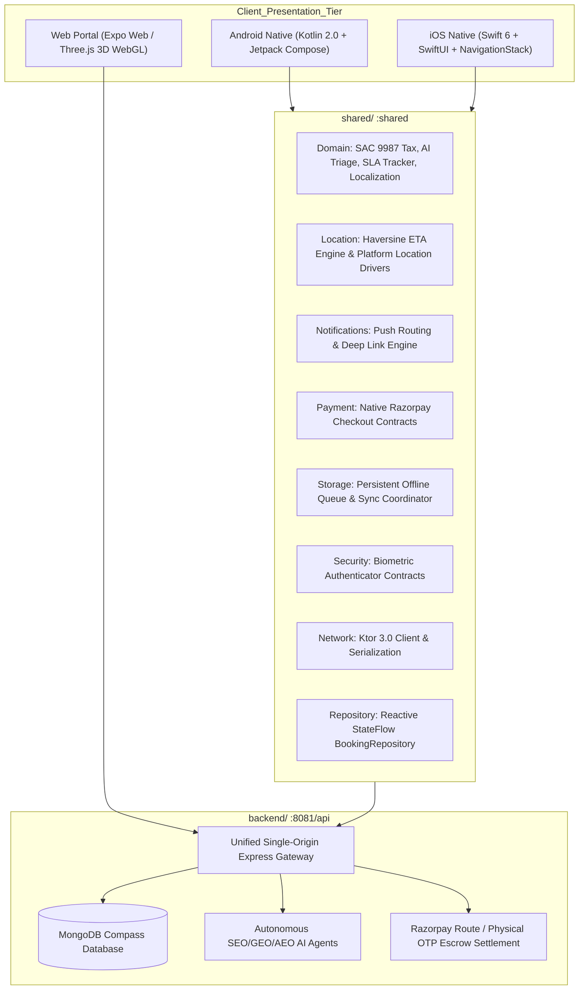

# Sheriyakam (ശരിയാക്കാം) - Native Multiplatform Platform

> **Kerala's On-Demand Emergency Electrical & Career Intelligence Network**  
> Pure Native Android (Kotlin 2.0 + Jetpack Compose) • Pure Native iOS (Swift 6 + SwiftUI) • Unified Web (Single-Port 8081) • Kotlin Multiplatform (KMP Domain)

[](https://github.com/sheriyakam/sheriyakam/actions/workflows/ci.yml)
[](tests/)
[](eslint.config.mjs)

---

## 🏛️ System Architecture

Sheriyakam is architected as a high-performance cross-platform system. Core business rules, validation, mathematical calculations, and offline synchronization are shared via **Kotlin Multiplatform (KMP)** in [`shared/`](shared/), while user interfaces are built using 100% native toolkits:

- **Android Native App**: Kotlin 2.0 + Jetpack Compose + Material 3 ([`androidApp/`](androidApp/))
- **iOS Native App**: Swift 6 + SwiftUI + `NavigationStack` ([`iosApp/`](iosApp/))
- **Unified Web Portal**: Single-Origin Metro & Express Gateway on port 8081 ([`app/`](app/))
- **Authoritative Backend**: Node.js / Express with MongoDB Compass & Autonomous SEO/GEO Agents ([`backend/`](backend/))



*For comprehensive architecture specifications, see [docs/ARCHITECTURE.md](docs/ARCHITECTURE.md).*

---

## 🛠️ Technology Matrix

| Layer | Technology | Primary Files / Modules |
| :--- | :--- | :--- |
| **Android Native** | Kotlin 2.0, Jetpack Compose, Material 3, WorkManager, Razorpay Android SDK | [`androidApp/`](androidApp/), [`MainActivity.kt`](androidApp/src/main/kotlin/com/sheriyakam/android/MainActivity.kt) |
| **iOS Native** | Swift 6, SwiftUI, NavigationStack, BackgroundTasks, Razorpay iOS | [`iosApp/`](iosApp/), [`SheriyakamApp.swift`](iosApp/SheriyakamApp.swift) |
| **Shared Domain** | Kotlin Multiplatform (KMP), Ktor 3.0, Location, Push, Payment Contracts | [`shared/`](shared/), [`PaymentSplit.kt`](shared/src/commonMain/kotlin/com/sheriyakam/domain/PaymentSplit.kt) |
| **Web Portal** | Expo Router v3, React Native Web, Three.js WebGL (sub-second LCP) | [`app/`](app/) |
| **Backend & Agents** | Express.js, MongoDB Compass, Claude AI | [`backend/server.js`](backend/server.js), [`AgentOrchestrator.js`](backend/agents/AgentOrchestrator.js) |

---

## 🚀 Getting Started

### 1. Unified Local Development (Port 8081)
Start the unified client and REST API server with a single command:
```bash
npx expo start --web
```
- **Web Portal**: [http://localhost:8081](http://localhost:8081)
- **AI Career Optimizer**: [http://localhost:8081/cv-linkedin-optimize](http://localhost:8081/cv-linkedin-optimize)
- **Backend API Probe**: [http://localhost:8081/api/health](http://localhost:8081/api/health)

### 2. Native Android Build
```bash
./gradlew :androidApp:assembleDebug    # Debug APK
./gradlew :androidApp:bundleRelease    # Release AAB for Google Play Store
```

### 3. Native iOS Build (macOS with Xcode 15/16)
```bash
./gradlew :shared:linkDebugFrameworkIosSimulatorArm64   # Build KMP Framework
xcodebuild -workspace iosApp.xcworkspace -scheme iosApp -configuration Debug build
```

### 4. Static Production Web Export
```bash
npx expo export -p web                 # Exports 148 pre-rendered static routes to dist/
```

### 5. Automated Verification
```bash
npm test                               # Run 65 automated contract and domain tests
```

---

## 📱 Feature Capabilities

- **Zero-WebView Native Apps**: 100% native Compose components on Android and 100% native SwiftUI components on iOS.
- **Kerala Road ETA Engine**: Haversine distance calculator with Kerala urban arterial speed index (28 km/h) and road curvature factors.
- **Biometric Security**: Hardware-backed biometric authentication (Android BiometricPrompt, iOS Face ID / Touch ID) for high-value dispatch actions.
- **Offline Mutation Sync**: Persistent Key-Value offline mutation queue with exponential backoff and background reconciliation via Android WorkManager and iOS BackgroundTasks.
- **SAC 9987 Tax & Split Math**: Exact integer arithmetic preventing IEEE 754 floating-point inaccuracies during GST split computation.
