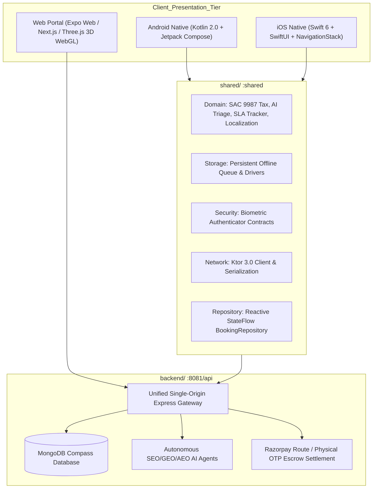

# Sheriyakam Cross-Platform Architecture Reference

This document details the multiplatform architecture of **Sheriyakam (ശരിയാക്കാം)**, providing a performance-optimized, native experience across Android, iOS, and Web while sharing core domain logic via **Kotlin Multiplatform (KMP)**.

---

## 🏛️ System Architecture Diagram



---

## 📦 Module Organization

```text
sheriyakam/
├── shared/                         # Kotlin Multiplatform Library (:shared)
│   ├── build.gradle.kts
│   ├── src/commonMain/kotlin/
│   │   ├── com/sheriyakam/domain/      # Tax math, SLA tracker, phone validation, triage, bilingual engine
│   │   ├── com/sheriyakam/network/     # Ktor 3.0 client, models, offline mutation queue
│   │   ├── com/sheriyakam/repository/  # StateFlow booking repository & state machines
│   │   ├── com/sheriyakam/storage/     # Persistent offline queue & KeyValue drivers
│   │   └── com/sheriyakam/security/    # Cross-platform biometric authenticator interface
│   ├── src/androidMain/kotlin/         # Android SharedPreferences & BiometricManager bindings
│   ├── src/iosMain/kotlin/             # iOS NSUserDefaults & LocalAuthentication bindings
│   └── src/commonTest/kotlin/          # KMP unit & contract tests (Ktor MockEngine, Storage)
├── androidApp/                     # Native Android Application
│   ├── build.gradle.kts            # AGP 8.6.1 + Kotlin 2.0.21 + Jetpack Compose
│   ├── proguard-rules.pro          # Production R8 keep rules for KMP serializable models
│   └── src/main/
│       ├── AndroidManifest.xml
│       └── kotlin/com/sheriyakam/android/
│           ├── MainActivity.kt     # Jetpack Compose Host & Deep Link handler
│           ├── navigation/         # Compose AppNavigation routing
│           └── ui/                 # ActiveDispatchTracker, BookingCheckout, SmartTriage, NetworkStatusBanner
├── iosApp/                         # Native iOS Application
│   ├── Package.swift               # Swift 6 Package definition
│   ├── SheriyakamApp.swift         # SwiftUI @main entry
│   ├── Configuration/Info.plist    # Face ID (NSFaceIDUsageDescription) & Location privacy manifests
│   ├── Navigation/AppNavigation.swift # SwiftUI NavigationStack router with sheriyakam:// URL schema
│   └── Views/                      # ActiveDispatchTrackerView, BookingCheckoutView, SmartTriageView
├── app/                            # Universal Web Client (Expo Router v3)
│   ├── index.js                    # Awwwards-caliber 3D WebGL Three.js grid & CodeHype product badge
│   ├── cv-linkedin-optimize/       # Deterministic AI Resume Builder & LinkedIn Optimizer
│   └── (148 static routes)         # Full pre-rendered coverage for all 14 Kerala districts
├── backend/                        # Authoritative REST API & Autonomous Agents
│   ├── server.js                   # Modular Express gateway mounted on unified port 8081
│   ├── routes/                     # Auth webhooks (/api/auth) and agent controls (/api/agents)
│   └── agents/                     # Autonomous SEO, GEO/AEO, and content freshness sweepers
├── metro.config.js                 # Single-origin reverse proxy directing /api/* traffic to Express
└── tests/                          # Automated contract and regression test suites (40 tests)
```

---

## 🔒 Security & Physical Escrow Workflow

1. **Two-Step Physical OTP**:
   - **Step 1 (Arrival Check-In)**: Verified on wireman arrival before circuit diagnostics begin. Transitions booking state from `ACCEPTED` to `IN_PROGRESS`.
   - **Step 2 (Completion OTP)**: Customer only reveals after physical power test passes. Settles payment from escrow to technician.
2. **Escrow Locking & Damage Disputes**:
   - Customers can freeze payout instantaneously via `disputeBooking(id, reason)` which flags `payoutStatus = "ESCROW_LOCKED"`.
3. **Hardware Biometric Guardrails**:
   - Wiremen authenticate on-site check-in using Android `BiometricPrompt` or iOS Face ID (`LocalAuthentication`).

---

## 🚀 Build & Execution Commands

### 1. Unified Local Development (Single Port 8081)
```bash
npx expo start --web
```
- Web Application: `http://localhost:8081`
- REST API Health Probe: `http://localhost:8081/api/health`

### 2. Native Android Build
```bash
./gradlew :androidApp:assembleDebug    # Debug APK
./gradlew :androidApp:bundleRelease    # Play Store Production AAB
```

### 3. Native iOS Build (macOS with Xcode 15/16)
```bash
./gradlew :shared:linkDebugFrameworkIosSimulatorArm64   # Build KMP iOS Framework
xcodebuild -workspace iosApp.xcworkspace -scheme iosApp -configuration Debug build
```

### 4. Static Production Web Export
```bash
npx expo export -p web                 # Exports 148 static routes to dist/
```

### 5. Automated Verification & Quality Gates
```bash
npm test                               # Run 40 automated contract & domain tests
npm run lint                           # Run ESLint 9 across repository
npx tsc --noEmit                       # TypeScript compiler type check
```
